<h3><code>joao@github ~ $ ./contributions.sh</code></h3>

  

<h3><code>joao@github ~ $ whoami</code></h3>
<table>
  <tr>
    <td valign="top"></td>
    <td valign="top"></td>
  </tr>
</table>

 

<a href="https://www.linkedin.com/in/joao-oliiveira">LinkedIn</a> ·
<a href="https://www.instagram.com/liveira.tech">Instagram @liveira.tech</a> ·
<a href="https://github.com/JoaoVitorOCS/brain">brain</a> ·
<a href="https://github.com/JoaoVitorOCS/radar">radar</a> ·
<a href="https://github.com/JoaoVitorOCS/jarvis">jarvis</a>

